# CFD Framework — Analysis and Results

This document presents the experimental analysis and evaluation of a two-dimensional computational fluid dynamics (CFD) framework developed in Python. The project investigates aerodynamic flow behaviour around different geometries, with particular focus on a NACA 2412 airfoil at varying angles of attack. Numerical experiments are used to examine flow-field characteristics, assess the behaviour of the implemented numerical methods, and compare their accuracy, stability and computational performance. The results are interpreted using flow visualisations and quantitative measurements, with consideration given to the limitations of the numerical model and the reliability of the conclusions drawn.

## 1. Solver Behaviour and Validation

### 1.1 Flow Visualisation

The solver was tested using a circular obstacle placed within the computational domain. The speed magnitude was calculated from the momentum and density fields at each cell, allowing the flow to be visualised over time. Solid cells were masked from the plot, and a consistent colour scale was maintained across all frames to make changes in the flow field directly comparable.

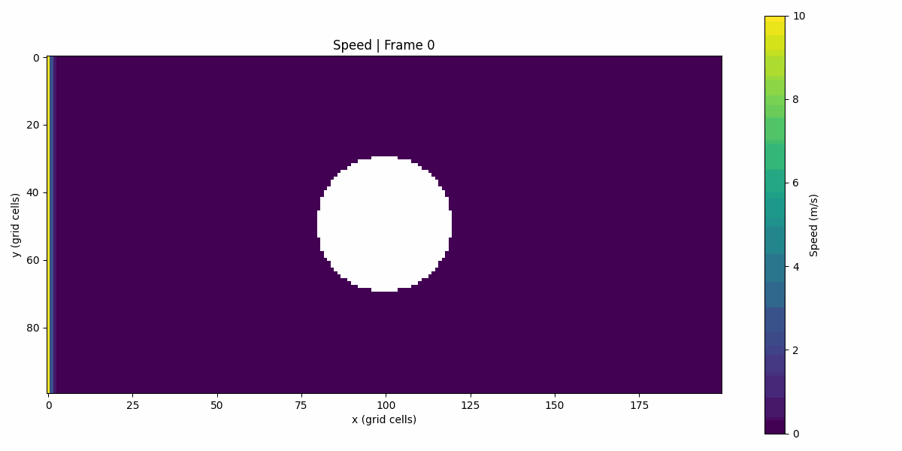

*Figure 1: Evolution of the speed magnitude around a circular obstacle, with solid cells masked and a consistent colour scale across frames.*

The animation provides a qualitative assessment of the solver's behaviour as the flow interacts with the obstacle. It allows changes in the velocity field to be observed over time and helps identify unexpected behaviour, including regions where the computed flow differs from the intended freestream conditions. This type of visualisation is useful for debugging and interpreting the numerical solution, although it does not independently establish that the results are physically accurate.

### 1.2 Numerical Stability

A Courant–Friedrichs–Lewy (CFL) condition is used to monitor the stability constraints associated with the explicit time-stepping scheme. The CFL value is recalculated as the simulation progresses, accounting for changes in the timestep and flow conditions. The framework checks that the CFL number remains below 1, helping to prevent the timestep from exceeding the chosen stability limit.

This check provides a useful safeguard against excessively large timesteps. However, satisfying the CFL condition alone does not guarantee numerical stability or physical accuracy. The behaviour of the solution also depends on the numerical fluxes, boundary conditions, grid resolution and treatment of solid boundaries.

### 1.3 Identified Limitation: Freestream Velocity

Testing revealed an unresolved discrepancy between the prescribed inflow velocity and the velocity achieved in the ambient fluid. The computed ambient speed reaches approximately half of the specified freestream value.

This discrepancy is significant because the freestream velocity establishes the reference conditions for the simulation. An incorrect ambient velocity can affect derived quantities such as the Mach number and pressure coefficient, as well as the interpretation of flow behaviour around obstacles. Although the solver produces a visualisable flow field, this issue means that its quantitative results must be treated with caution until the cause has been identified.

The source of the discrepancy has not yet been established. Potential areas for further investigation include the initial and boundary conditions, the conversion between conservative and primitive variables, and the numerical flux implementation. These are possible diagnostic avenues rather than confirmed causes.

### 1.4 Validation Assessment

The current validation demonstrates that the framework can evolve a flow field, visualise its behaviour around a solid obstacle, and monitor the CFL condition during simulation. However, these checks are not sufficient to establish quantitative accuracy. In particular, the freestream velocity discrepancy remains an important limitation, and the visual agreement of a flow field with expected behaviour should not be treated as proof of correctness.

Consequently, the framework is best regarded as a working numerical simulation and experimentation platform whose quantitative reliability requires further validation. Future validation should establish that uniform-flow conditions are reproduced correctly and compare selected results against analytical solutions or established reference data where appropriate.

## 2. Geometry Experiments

### 2.1 Comparison of Rectangular and Rounded Boundaries

<table>
  <tr>
    <td align="center">
      
       
      <em>Rectangular obstacle</em>
    </td>
    <td align="center">
      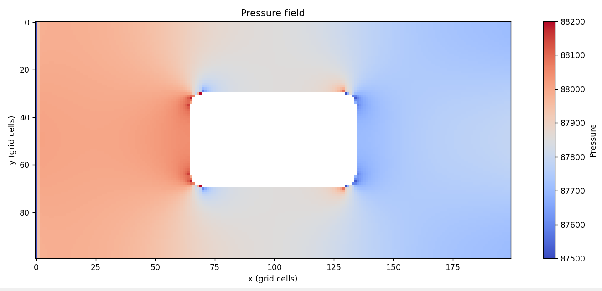
       
      <em>Rounded-rectangle obstacle</em>
    </td>
  </tr>
</table>

*Figure 3: Computed pressure distributions around rectangular and rounded-rectangle obstacles under identical simulation conditions.*

The pressure distributions show a noticeable difference around the obstacle corners. In the rounded-rectangle simulation, the pressure transition around the corners is more gradual than in the rectangular case. Lower pressure is also observed in the regions around the rounded obstacle, although this should not be interpreted as a reduction across the entire domain without further quantitative comparison.

The speed-magnitude plots provide additional context for these observations. Both geometries produce broadly similar large-scale flow patterns, with low-speed regions alongside the obstacle and higher speeds above and below it. However, local differences appear near the corners, where the change in boundary shape affects the computed speed distribution. The rounded boundary produces a different local flow pattern from the sharp-cornered rectangle, although the discretised representation of the geometry may also contribute to these differences.

Taken together, the pressure and speed fields demonstrate that modifying the obstacle geometry changes the computed flow solution, particularly near the corners. Because the simulations use identical conditions, the geometry is the principal intended difference between the cases. Nevertheless, these visual comparisons do not establish whether either geometry produces lower drag or more physically accurate results. Quantitative measurements and further validation would be required to support those conclusions.

### 2.2 Comparison of Circular and Elliptical Boundaries

<table>
  <tr>
    <td align="center">
      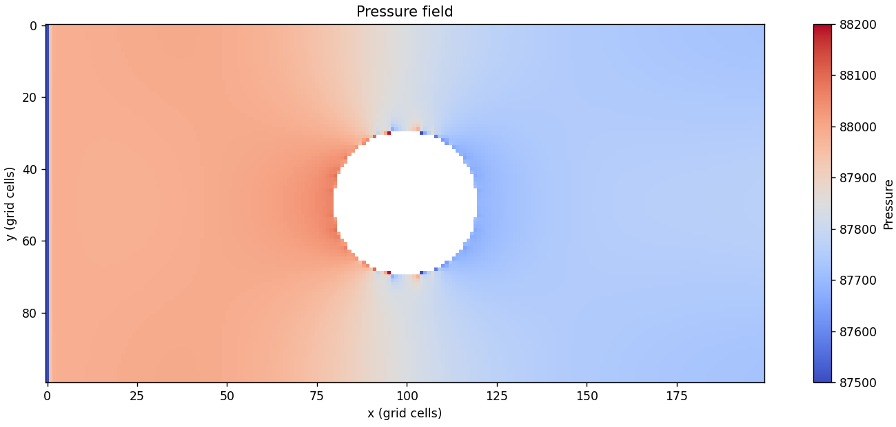
       
      <em>Circular obstacle</em>
    </td>
    <td align="center">
      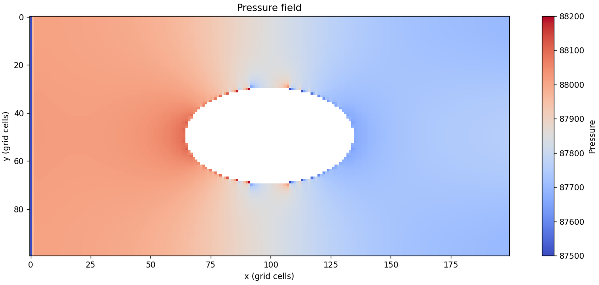
       
      <em>Elliptical obstacle</em>
    </td>
  </tr>
</table>

*Figure 4: Computed pressure distributions around circular and elliptical obstacles under identical simulation conditions.*

The pressure fields show a broadly similar left-to-right gradient for both geometries, with higher pressure on the left side of the obstacle and lower pressure on the right. However, the distribution around the obstacle differs with its shape. The circular obstacle produces a more compact disturbance, whereas the ellipse produces a wider pressure disturbance in the horizontal direction, consistent with its greater horizontal extent. The pressure transition is also distributed across a broader region around the ellipse.

The speed-magnitude fields provide further insight into these differences. Both cases exhibit a low-speed region immediately around the sides of the obstacle and higher speeds above and below it. In the elliptical case, the low-speed region extends farther horizontally, following the obstacle's elongated shape. The high-speed regions above and below the obstacle also appear broader than in the circular case.

These observations indicate that the obstacle's geometry influences the spatial distribution of the computed pressure and speed fields. The circle produces a more compact pattern, while the ellipse produces a more horizontally extended pattern. However, these visualisations alone cannot establish which geometry has lower drag or produces a more physically accurate solution. Such conclusions would require quantitative comparisons and further validation of the solver.

### 2.3 Comparison of Wedge and Diamond Boundaries

<table>
  <tr>
    <td align="center">
      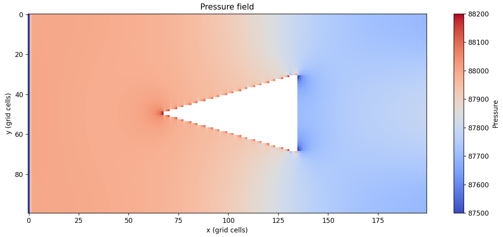
       
      <em>Wedge obstacle</em>
    </td>
    <td align="center">
      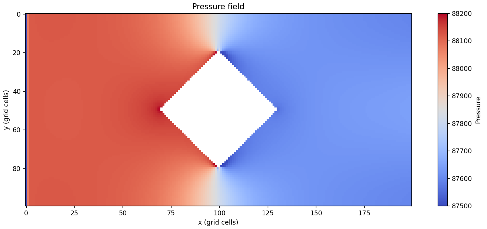
       
      <em>Diamond obstacle</em>
    </td>
  </tr>
</table>

*Figure 5: Computed pressure distributions around diamond-shaped and wedge-shaped obstacles under identical simulation conditions.*

The pressure fields show a higher-pressure region upstream of each obstacle and a lower-pressure region downstream. However, the spatial distribution differs between the two geometries. The diamond produces a relatively symmetric pressure pattern around its pointed leading and trailing ends. In contrast, the wedge produces an asymmetric pattern, with a pointed upstream end and a flat downstream face. The pressure transition near the downstream face is more abrupt than the more gradual spatial variation visible around the diamond's sloping boundaries.

The speed-magnitude fields reinforce this geometric difference. Both obstacles produce low-speed regions alongside their surfaces and higher speeds above and below them. The diamond's flow pattern is broadly symmetric about its horizontal centreline, reflecting the symmetry of its geometry. The wedge also shows higher-speed regions above and below the obstacle, but its low-speed region is elongated towards the pointed upstream end and terminates near the flat downstream face.

These results demonstrate that changing the obstacle's shape and orientation affects the computed pressure and speed distributions. The diamond produces a more symmetric flow pattern, whereas the wedge produces a more asymmetric distribution associated with its different leading- and trailing-edge geometry. Nevertheless, the visualisations alone do not establish differences in drag, separation behaviour, or physical accuracy. Quantitative measurements and further solver validation would be required to draw those conclusions.

## 3. NACA 2412 Airfoil

### 3.1.1 Speed Distribution at ±10°

The speed-magnitude distributions at angles of attack of −10° and +10° are shown in Figure 6. At −10°, the highest-speed region begins near the leading edge of the airfoil and extends downwards, while the lowest-speed region is located along the lower surface, behind the trailing edge. At +10°, the highest-speed region begins near the leading edge and extends upwards, while the lowest-speed region lies along the upper surface and extends downstream. The two distributions appear approximately mirrored, with the high- and low-speed regions occupying corresponding positions on opposite sides of the airfoil. However, the low-speed region in the +10° case is more clearly defined. This difference suggests that reversing the angle of attack does not produce an identical mirrored flow field. The camber of the NACA 2412 may contribute to this asymmetry, although numerical effects may also influence the computed distributions.

<table>
  <tr>
    <td align="center">
      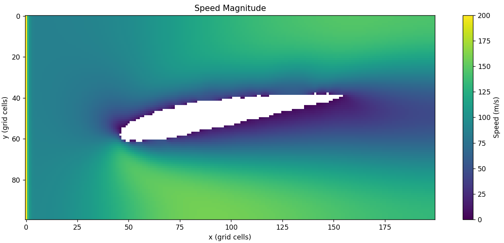
       
      <em>-10 Angle of Attack</em>
    </td>
    <td align="center">
      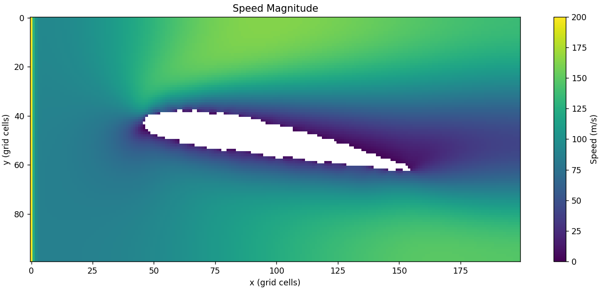
       
      <em>+10 Angle of Attack</em>
    </td>
  </tr>
</table>

*Figure 6: Comparison of speed-magnitude distributions around the NACA 2412 airfoil at angles of attack of -10° and +10°. Both simulations use a specified inflow speed of 200 m/s.*

### 3.1.2 Pressure Distribution at ±10°

The pressure distributions at −10° and +10° are compared in Figure 7. At −10°, the highest-pressure region occurs near the leading edge, along the forward-facing surface, while the lowest-pressure region is located directly below it, along the downward-facing surface. At +10°, the highest-pressure region also occurs near the forward-facing edge, while the lowest-pressure region extends more broadly above the airfoil. The high-pressure region between approximately x=0 and x=50 appears slightly more pronounced in the +10° case. Overall, the two pressure fields exhibit broadly similar patterns, but differences remain in the shape and extent of their high- and low-pressure regions. Therefore, reversing the angle of attack produces some similarities in the pressure distribution, but not an exact mirror image. This is consistent with the cambered geometry of the NACA 2412, although the plots alone cannot establish the accuracy of the computed pressures or quantify aerodynamic forces.

<table>
  <tr>
    <td align="center">
      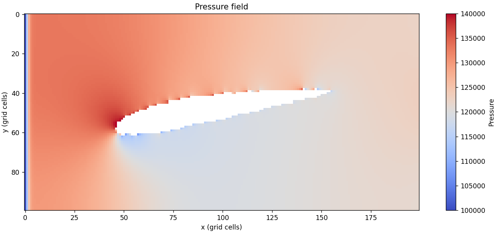
       
      <em>-10 Angle of Attack</em>
    </td>
    <td align="center">
      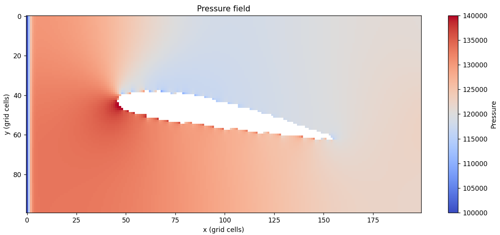
       
      <em>+10 Angle of Attack</em>
    </td>
  </tr>
</table>

*Figure 7: Comparison of pressure distributions around the NACA 2412 airfoil at angles of attack of -10° and +10°. Both simulations use a specified inflow speed of 200 m/s.*

### 3.2 Plausibility of 20° Angle of Attack

<table>
  <tr>
    <td align="center">
      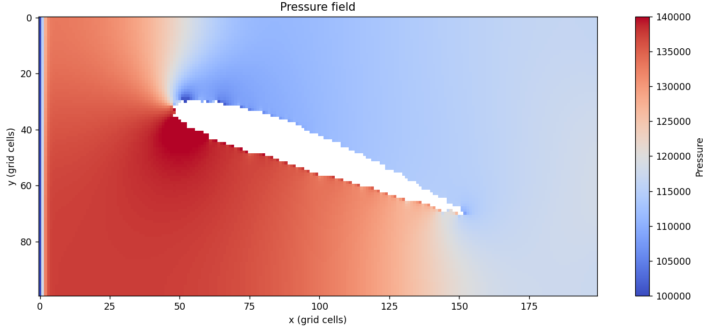
       
      <em>+20 Angle of Attack Pressure</em>
    </td>
    <td align="center">
      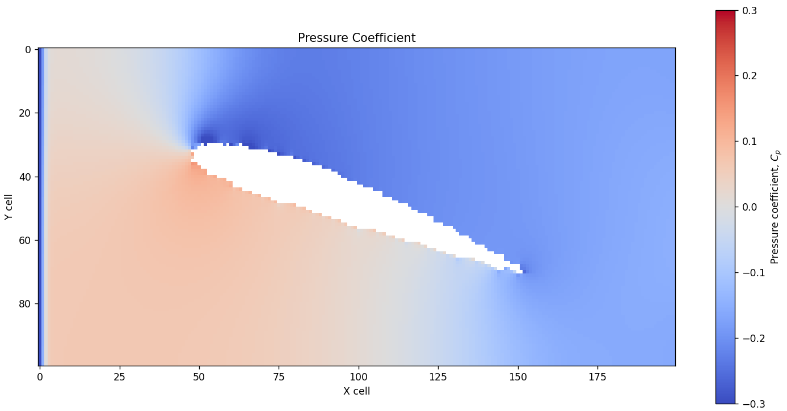
       
      <em>+20 Angle of Attack Pressure Coefficient</em>
    </td>
  </tr>
</table>

*Figure 8: Pressure field (left) and pressure coefficient distribution (right) around a NACA 2412 airfoil at an angle of attack of 20°. The pressure coefficient is calculated relative to a reference pressure selected from the simulated pressure field.*

The pressure field and corresponding pressure coefficient distribution for the NACA 2412 airfoil at an angle of attack of 20° are shown in Figure 8. The pressure field on the left shows a clear variation in pressure around the airfoil. A region of relatively high pressure develops near the leading edge and along the lower surface, while lower pressures occur above the airfoil and towards the downstream region. The difference between the upper and lower surface pressures is consistent with the asymmetric flow expected around a cambered airfoil at a high positive angle of attack.

The pressure coefficient, shown on the right expresses the local pressure relative to the chosen reference pressure, scaled by the freestream dynamic pressure. Positive values indicate pressure above the reference pressure, while negative values indicate pressure below it. The plot therefore highlights the pressure variations more clearly than the dimensional pressure field. The region of positive pressure around the leading edge and lower surface contrasts with the negative-pressure region above the airfoil, particularly towards the leading edge and upper surface.

The two plots show corresponding spatial patterns: regions of high pressure generally appear as positive pressure coefficients, while regions of low pressure appear as negative coefficients. This correspondence provides a useful check that the pressure coefficient has been calculated and visualised consistently with the pressure field.

However, the plots alone do not establish the quantitative accuracy of the solution. The pressure coefficient depends on the reference pressure and freestream dynamic pressure used in its calculation. In this case, the reference pressure was selected using the pressure field rather than taken directly from the original inlet value, because the pressure near the inlet boundary appeared unusually low. This choice should be interpreted as an estimate of the reference pressure within the simulated domain; its suitability depends on whether the selected region adequately represents undisturbed freestream conditions. The observed distributions are therefore useful for examining the solver's qualitative behaviour, but comparison against an established reference solution would be required to assess their accuracy.

### 3.3 Effect of Angle of Attack

**Pressure distribution**

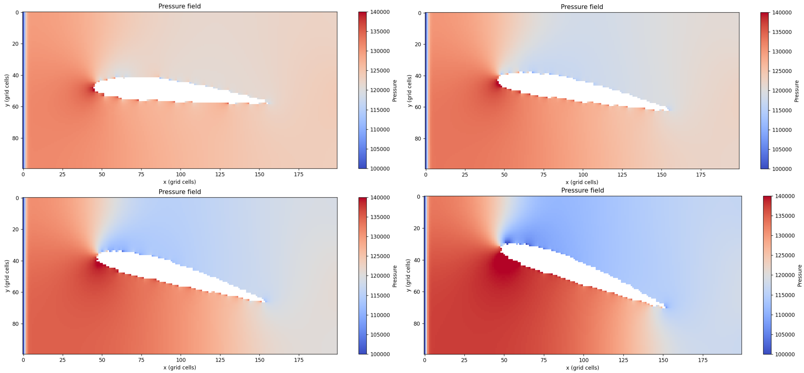

*Figure 9: Pressure distributions around the NACA 2412 airfoil at angles of attack of 5° (top left), 10° (top right), 15° (bottom left) and 20° (bottom right). All plots use the same pressure colour scale.*

At 5°, the pressure field is relatively uniform across much of the domain, although a region of increased pressure develops near the leading edge and along the lower surface. As the angle of attack increases to 10° and 15°, the pressure distribution becomes more pronounced. The high-pressure region near the leading edge and below the airfoil becomes more clearly defined, while a region of lower pressure develops above the airfoil and extends further into the downstream flow. This produces a more distinct contrast between the pressure fields on the upper and lower sides of the airfoil.

At 20°, these differences are most pronounced. A substantial region of high pressure extends from the leading edge along the lower side of the airfoil, while lower pressures are visible above the airfoil and across much of the downstream region. The increasing contrast between these regions indicates that the computed pressure field becomes increasingly asymmetric as the angle of attack rises. This is qualitatively consistent with the expected change in the flow around an airfoil as its orientation relative to the incoming flow changes.

Overall, the pressure plots show a clear progression with increasing positive angle of attack: the high-pressure region near the leading edge and lower surface becomes more prominent, while the low-pressure region above the airfoil becomes more extensive and distinct. These observations demonstrate that the solver responds to changes in airfoil orientation by producing different pressure distributions. However, the contour plots alone cannot establish the quantitative accuracy of these distributions or determine the resulting lift and drag forces. Furthermore, the pronounced pressure variations at 20° warrant particular caution, as pressure contours alone are insufficient to establish whether the simulated flow features are physically accurate.

**Speed distribution**

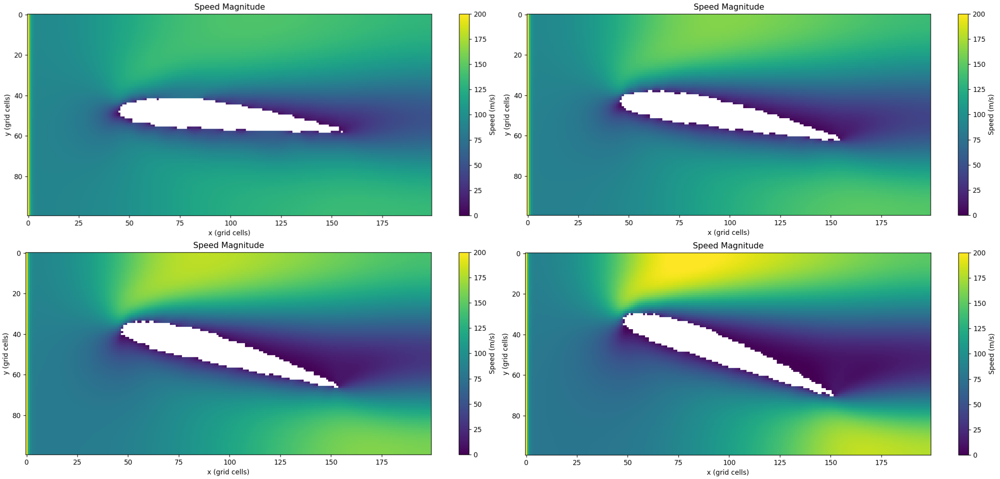

*Figure 10: Speed distributions around the NACA 2412 airfoil at angles of attack of 5° (top left), 10° (top right), 15° (bottom left) and 20° (bottom right). All plots use the same pressure colour scale.*

At 5°, a low-speed region is visible around the airfoil, particularly near the leading edge and along the region extending downstream from it. The surrounding flow has a comparatively gradual variation in speed. At 10°, the low-speed region becomes more pronounced along the lower side of the airfoil in the displayed coordinate system, extending further downstream. A higher-speed region also begins to develop above the airfoil and away from its leading edge.

These patterns become increasingly distinct at 15° and 20°. The low-speed region extends along a greater proportion of the airfoil and into the downstream wake, while a high-speed region develops above the airfoil. At 20°, this higher-speed region is particularly prominent, with the plotted magnitude approaching the upper limit of the shared colour scale. The speed field therefore becomes more strongly differentiated around the airfoil as the angle of attack increases.

The speed distributions broadly correspond with the pressure fields: regions of lower pressure above the airfoil coincide with areas of increased speed, while the high-pressure region near the leading edge and lower surface is associated with lower speeds in the surrounding flow. This qualitative relationship is consistent with the expected connection between pressure and flow acceleration around an airfoil. However, the plots show speed magnitude rather than velocity direction, so they cannot independently establish the detailed flow path or demonstrate flow separation. In addition, the colour scale's upper limit of 200 m/s means that any regions reaching this limit may conceal higher computed values.

### 3.4 Airfoil Findings

The NACA 2412 airfoil experiments demonstrate that the solver produces different pressure and speed distributions as the angle of attack changes. Comparing the results at -10° and +10° revealed broadly similar patterns, but not exact mirror images. This is consistent with the airfoil's cambered geometry, which means that reversing the angle of attack does not produce the same conditions on opposite sides of the airfoil. Across the positive angles of attack from 5° to 20°, the pressure fields show an increasingly pronounced contrast between the high-pressure region near the leading edge and lower surface and the lower-pressure region above the airfoil. The speed distributions also develop more distinct high- and low-speed regions as the angle of attack increases.

Overall, these experiments demonstrate that the framework can represent changes in the computed flow field in response to variations in airfoil orientation. The pressure coefficient plot at 20° also provides an alternative representation of the pressure distribution relative to a chosen reference pressure. However, these results should be interpreted as qualitative observations rather than quantitative validation. The contour plots alone cannot establish the accuracy of the computed flow, determine lift and drag, or confirm flow separation. Further evaluation against established reference data would be necessary to assess the solver's predictive accuracy.

## 4 Performance and Benchmarking

### 4.1 Benchmarking Methodology

The computational performance of the CFD framework was evaluated by measuring runtime per timestep under different grid sizes and sample sizes. All benchmarks were conducted on a PC equipped with an Intel Core i5-8350U processor running at 1.70 GHz.

To investigate the effect of grid size, both the Euler and Navier–Stokes solvers were tested using grids of 25x12, 50x25, 100x50, 200x100, 400x200, 800x400 and 1200x600 cells. Each benchmark consisted of 100 frames, with runtime data collected for every frame.

The effect of sample size was investigated by varying the number of simulated frames across 10, 20, 50, 100, 200, 500, 1,000, 2,000, 5,000 and 10,000. These tests used a 100x50 grid with a uniform, empty flow field, providing a consistent baseline for comparing computational cost as the number of frames increased.

Each benchmark was performed once. Consequently, the results represent individual measurements rather than averages across repeated runs, and may be affected by variations in system performance during execution.

### 4.2 Effect of Grid Size

<table>
  <tr>
    <td align="center">
      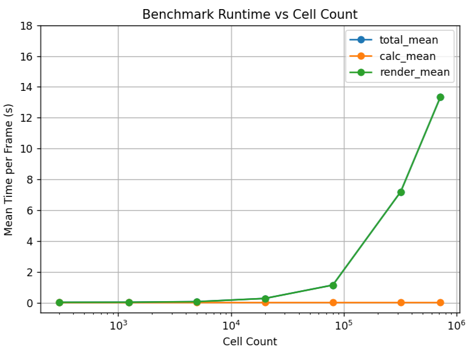
       
      <em>Euler</em>
    </td>
    <td align="center">
      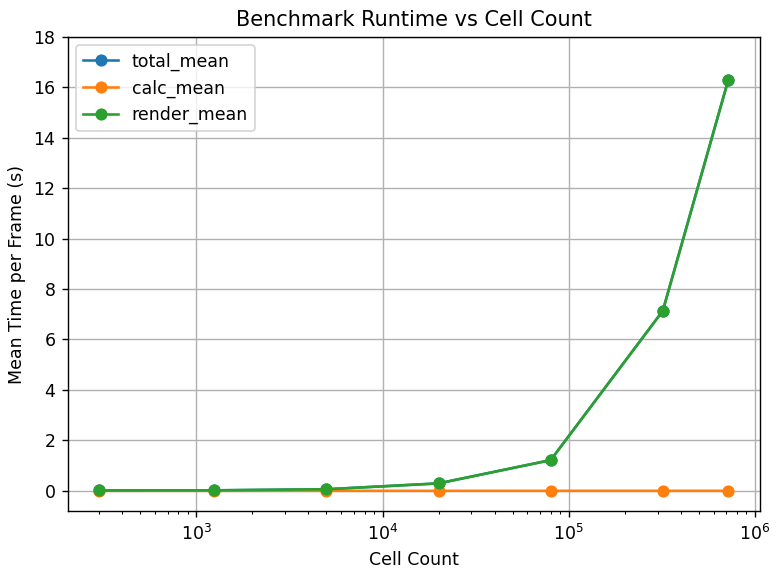
       
      <em>Navier-Stokes</em>
    </td>
  </tr>
</table>

*Figure 11: Comparison of total, calculation, and render time for Euler and Navier-Stokes when changing the number of cells to simulate*

The effect of grid size on computational performance was investigated using the Euler and Navier–Stokes solvers across seven grid resolutions, ranging from 25x12 (300 cells) to 1200x600 (720,000 cells). For each configuration, runtime was recorded over 100 frames, allowing the mean calculation time, rendering time and total time per frame to be compared.

The results show a substantial increase in total runtime as grid size increases. For the Euler solver, mean total time rises from approximately 0.0222s per frame at 300 cells to 13.34s per frame at 720,000 cells. For the Navier–Stokes solver, it increases from approximately 0.0178s to 16.30s per frame over the same range. This demonstrates that increasing spatial resolution significantly increases the computational cost of running and visualising the simulation.

A comparison of the individual timing components reveals that rendering accounts for most of the measured runtime, particularly at larger grid sizes. At 720,000 cells, the mean rendering times are approximately 13.34s per frame for Euler and 16.30s for Navier–Stokes, while their mean calculation times are approximately 0.0028s and 0.0021s, respectively. The recorded percentages indicate that rendering accounts for more than 99.9% of total runtime at this resolution. Consequently, the measured performance at high resolutions is dominated by visualisation rather than the numerical calculation itself.

The mean calculation times remain comparatively small across the tested grid sizes, although they do not remain perfectly constant. In contrast, rendering time increases sharply as the number of cells grows. This suggests that displaying the increasingly large simulation fields is the principal performance bottleneck in these benchmarks. Therefore, the total runtimes should not be interpreted as a direct measure of the computational efficiency of the Euler and Navier–Stokes solvers alone.

The comparison between the two solvers also varies with grid size. Navier–Stokes has a lower mean total runtime at the smallest grid sizes, whereas Euler is faster at some intermediate and larger resolutions. At the largest grid size, Navier–Stokes takes approximately 22% longer per frame than Euler. However, because each configuration was benchmarked only once and rendering dominates the measured time, these results are insufficient to establish a general ranking of the solvers' computational efficiency. Repeated measurements and benchmarks that separate numerical computation from rendering would be needed for a more reliable comparison.

### 4.3 Effect of Sample Size

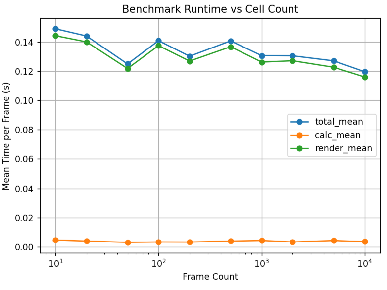

*Figure 12: Total, calculation, and render time when changing number of frames run*

The effect of sample size on computational performance was investigated by varying the number of simulated frames from 10 to 10,000, while keeping the grid size fixed at 100x50 cells and using a uniform, empty flow field. The mean calculation, rendering and total runtime per frame were recorded to determine whether increasing the number of simulated frames affected the average computational cost.

The results show that the mean total runtime per frame remains relatively consistent across the tested sample sizes. It decreases from approximately 0.149s at 10 frames to 0.120s at 10,000 frames, with most intermediate results falling between 0.125 and 0.145s per frame. This suggests that increasing the sample size does not cause a sustained increase in the average time required to process each frame under the tested conditions.

Rendering is consistently the largest component of the measured runtime, accounting for approximately 97\% of the total time in most cases. Mean rendering time remains within a relatively narrow range of approximately 0.116–0.144s per frame, whereas mean calculation time is generally around 0.003–0.005s per frame. This reinforces the finding from the grid-size benchmarks that visualisation dominates the measured runtime for the tested configuration.

Some unusually high maximum calculation times occur at sample sizes of 1,000 and 5,000 frames. These reach approximately 0.946s and 2.705s, respectively, substantially exceeding the typical calculation times. The corresponding increases in standard deviation indicate occasional timing spikes. However, because the mean and median calculation times remain much lower, these spikes do not appear to represent the typical cost of processing a frame. Their precise cause cannot be established from the timing data alone.

Overall, the sample-size benchmark suggests that increasing the number of simulated frames has little effect on the typical runtime per frame for a fixed grid and flow configuration. The total time required to complete a simulation will nevertheless increase as more frames are processed. Since each sample-size configuration was tested only once, the observed differences should be treated as indicative rather than conclusive.

### 4.4 Additional Performance Considerations

Two additional benchmarks investigated the effects of solid-cell percentage and vector spacing on rendering performance. In the solid-cell benchmark, the grid size was kept constant while the proportion of cells marked as solid increased from 10% to 95%. Mean rendering time remained within a relatively narrow range of approximately 0.062–0.069s per frame for most configurations, although a higher value of approximately 0.0665s was recorded at 80%. Overall, the results show no clear monotonic relationship between solid-cell percentage and rendering time under the tested conditions.

The vector-spacing benchmark investigated how the interval between displayed velocity arrows affects rendering performance. The interval specifies the number of grid cells between arrows in both the horizontal and vertical directions. For example, an interval of 1 draws an arrow at every cell, whereas an interval of 10 draws arrows at every ten cells in each direction.
As the interval increased from 1 to 10, mean rendering time decreased from approximately 0.120s to 0.032s per frame. This indicates that reducing the density of the displayed velocity vectors can substantially reduce rendering cost. The effect is consistent with the lower number of arrows that must be drawn at larger intervals. However, the decrease was not perfectly consistent between consecutive settings, and the interval-1 measurement was substantially higher than the subsequent measurements.

Across both benchmarks, calculation time remained much smaller than rendering time, accounting for approximately 1.6–5.7% of total runtime. These findings reinforce the earlier conclusion that visualisation is the principal performance bottleneck in the tested configurations. Since each configuration was measured only once, repeated benchmarks would be required to determine the consistency of the observed trends.

## 5. Conclusion

This project developed a two-dimensional computational fluid dynamics (CFD) framework in Python, capable of simulating flow around a range of geometries and visualising the resulting pressure, speed and other flow properties. The framework supports both Euler and Navier–Stokes simulations, allowing inviscid and viscous flow behaviour to be explored within a common simulation environment.

The geometry experiments demonstrated that changing an object's shape produces corresponding differences in the computed flow fields. Comparisons between rectangles and rounded rectangles, circles and ellipses, and diamonds and wedges revealed changes in the spatial distribution of pressure and speed around the geometries. The NACA 2412 airfoil experiments further demonstrated that changing the angle of attack from -20° to +20° produces different pressure and speed distributions. The comparisons between positive and negative angles also showed that the resulting fields were not exact mirror images, consistent with the airfoil's cambered profile.

The performance benchmarks identified rendering as the principal bottleneck in the tested configurations. Increasing grid resolution substantially increased total runtime, although the measured numerical calculation times remained comparatively small. The additional tests also showed that displaying fewer velocity arrows can reduce rendering time, whereas varying the proportion of solid cells produced no clear monotonic trend in rendering performance. These findings highlight the importance of distinguishing the computational cost of the solver from the cost of visualising its results.

Despite these capabilities, the results remain primarily qualitative. The discrepancy between the specified inflow velocity and the speed achieved in the surrounding flow raises questions about the boundary conditions and the resulting flow field. Furthermore, the pressure and speed contours do not independently establish quantitative accuracy, and no conclusions about lift, drag or flow separation can be confirmed from these plots alone. Although the solver includes a CFL condition to constrain the timestep, satisfying this condition does not by itself demonstrate numerical accuracy or physical validity.

Overall, the project provides a flexible foundation for further development of a two-dimensional CFD solver. The implementation supports experiments across multiple geometries and flow configurations, while the analysis has identified both performance characteristics and limitations that require further investigation. Future work should prioritise understanding the inflow behaviour, assessing the numerical results against established reference solutions, and improving visualisation performance before drawing stronger conclusions about the solver's predictive accuracy.

