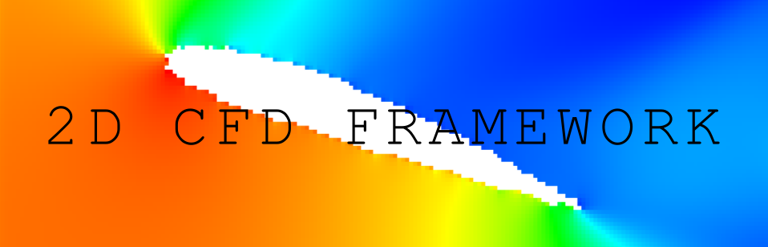

<div align="center">
  
</div>

----

A two-dimensional computational fluid dynamics (CFD) framework developed in Python to simulate aerodynamic flow around obstacles and investigate the behaviour of numerical methods.

The project explores how obstacle geometry influences the resulting pressure and velocity fields, while providing tools for visualising simulations, monitoring numerical stability and analysing computational performance. It includes a range of geometric shapes, from simple obstacles to NACA airfoils, and supports systematic comparisons between different simulation configurations.

## Features

- **Two-dimensional flow simulation:** Models compressible flow using conservative flow variables, including density, momentum and total energy.
- **Multiple geometries:** Supports several obstacle shapes, including circles, rectangles, ellipses, wedges, diamonds and NACA airfoils.
- **Flow visualisation:** Generates plots and animations of pressure, speed magnitude, velocity vectors, Mach number and vorticity.
- **Numerical stability monitoring:** Calculates and monitors the Courant–Friedrichs–Lewy (CFL) condition to help assess timestep stability.
- **Simulation data logging:** Records flow statistics over time, enabling trends and changes in the simulated flow to be investigated.
- **Numerical-method analysis:** Provides a basis for comparing the behaviour and computational performance of implemented numerical methods.

## Running the Simulator

### Interactive Simulation

Install the dependencies:

```bash
pip install pygame numpy matplotlib
```

Launch the simulator using:

```bash
python main.py
```

This starts the simulator with its default configuration, allowing you to interact with the simulation and explore the framework.

### Example Usage

Run the documented example using:

```bash
python usage.py
```

The example demonstrates how to initialise the simulator, configure a geometry, collect simulation metrics, and optionally export snapshots and CSV data. Its output depends on the configuration selected in `usage.py`.

## Configuration

The simulation can be customised through `usage.py` and the framework's constants file, `CFD/constants.py`.

### Example Configuration

Edit [`usage.py`](usage.py) to configure the example simulation. Depending on the options exposed by the framework, you can change:

- **Geometry:** Select an obstacle such as a circle, rectangle, ellipse, wedge, diamond, rounded rectangle or NACA airfoil.
- **Angle of attack:** Set the orientation of an airfoil.
- **Simulation duration:** Specify the number of frames to run.
- **Data collection:** Choose which flow metrics to record.
- **Snapshot export:** Enable snapshot saving and configure its frequency.

### Framework Defaults

The file [`CFD/constants.py`](CFD/constants.py) contains default settings and other constants used throughout the framework. These include:

- **Computational grid:** Screen dimensions and the number of cells in each direction.
- **Initial conditions:** Default fluid and freestream density, velocity and temperature.
- **Numerical methods:** Default equation set, numerical flux method, ratio of specific heats and fluid transport properties.
- **Visualisation:** Default scalar field, colour scale, vector field, vector spacing and vector scale.
- **Boundary behaviour:** Settings controlling persistent inflow, persistent outflow and slip walls.
- **Simulation settings:** Default timestep and simulation speed.
- **Data collection:** Available metrics for recording quantities such as speed, pressure, density, temperature, Mach number and CFL value.

Changing these constants can affect the framework's default behaviour across simulations. Some settings may be overridden by the graphical interface or explicitly supplied configuration, so check how each constant is used before changing it.

## How It Works

The framework represents the fluid as a two-dimensional grid of cells. Each cell stores the variables needed to describe the local flow state, while solid cells define the geometry of an obstacle.

At each timestep, the solver calculates numerical fluxes between neighbouring cells and uses them to update the conservative flow variables. Boundary conditions and solid-wall treatments are then applied to represent the interaction between the fluid and the computational domain's boundaries and obstacles.

The timestep is monitored using the CFL condition, which relates the timestep to the grid spacing and the speeds at which information propagates through the flow. Simulation data can be saved and processed separately to produce visualisations and quantitative measurements.

This approach makes it possible to investigate how changing the obstacle geometry or simulation configuration affects the computed flow field, as well as to examine the numerical behaviour and computational cost of the solver.

## Key Results

Initial experiments demonstrate that obstacle geometry influences the spatial distribution of pressure and speed within the computed flow field. Comparisons between rectangular and rounded-rectangle obstacles, circular and elliptical obstacles, and diamond and wedge geometries reveal differences in the patterns surrounding their boundaries.

The framework has also been applied to a NACA 2412 airfoil over a range of angles of attack, providing a basis for investigating how changes in orientation affect the computed flow field. Benchmarking experiments have additionally been used to examine the performance of the implemented numerical methods.

These results demonstrate the framework's ability to run simulations and support comparative analysis. They should, however, be interpreted in light of the solver's current limitations rather than as validated aerodynamic predictions.

## Further Documentation

- [`ANALYSIS.md`](ANALYSIS.md) — Experimental results, geometry comparisons, airfoil simulations and performance benchmarks.
- [`POSTMORTEM.md`](POSTMORTEM.md) — Reflections on the development process, implementation challenges and lessons learned.

## Limitations

The framework is an ongoing numerical project, and its results are not yet fully validated against analytical solutions or trusted reference simulations.

One identified limitation is that the ambient flow speed can reach only approximately half the specified inflow velocity under the tested conditions. This discrepancy affects the interpretation of the resulting flow fields and needs further investigation before the solver can be relied upon for quantitative aerodynamic predictions.

The visualisations are therefore most useful at present for examining the framework's behaviour, comparing simulation configurations and identifying areas for further numerical investigation.
